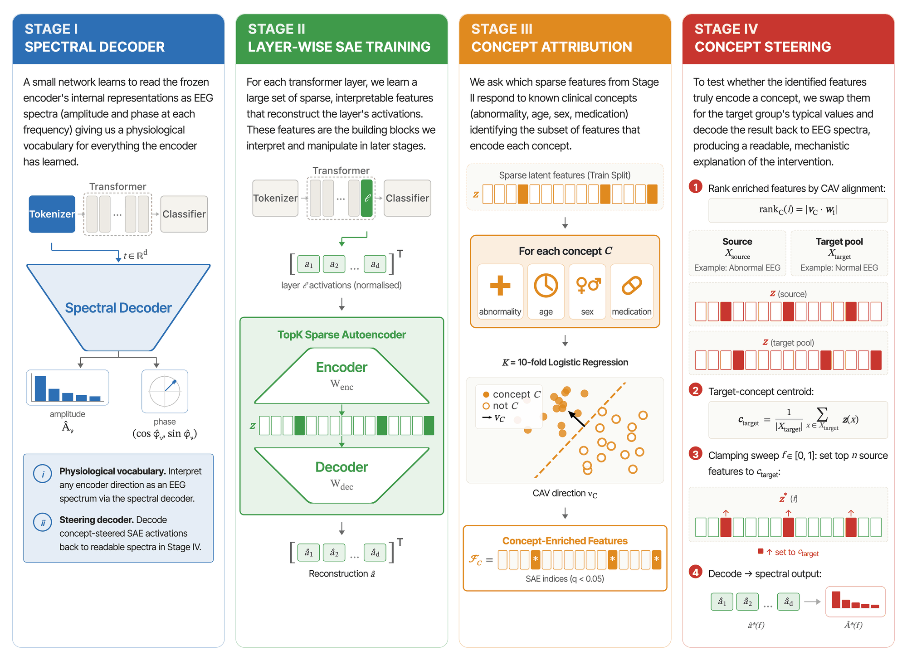
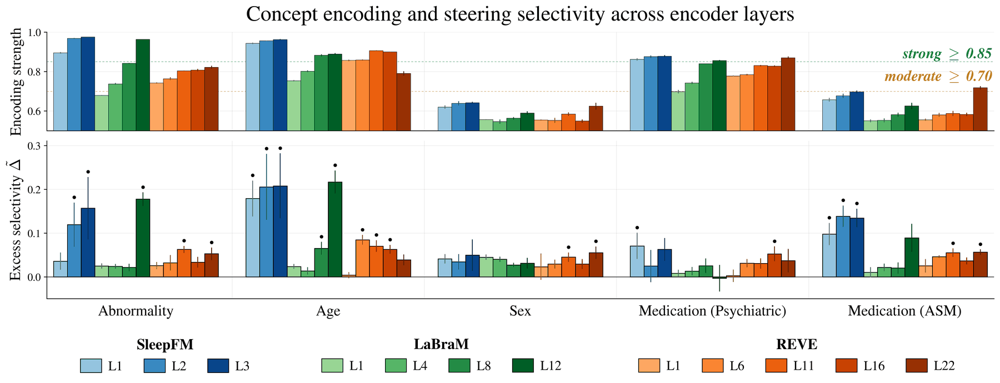

<div align="center">

# Mechanistic Interpretability of EEG Foundation Models via Sparse Autoencoders

**NeurIPS 2026**

William Lehn-Schiøler · Magnus Ruud Kjær · Rahul Thapa · Magnus Guldberg Pedersen · Anton Mosquera Storgaard · Nick Williams · Andreas Brink-Kjær · Tue Lehn-Schiøler · Sadasivan Puthusserypady · James Zou · Lars Kai Hansen

BrainCapture · Technical University of Denmark (DTU Health Tech, DTU Compute) · Stanford University · Seer Medical

[**Paper (PDF)**](paper/Mechanistic_Interpretability_of_EEG_Foundation_Models_via_Sparse_Autoencoders.pdf) &nbsp;·&nbsp;
[**Interactive explorer**](https://ai.braincapture.dk/mechanistic-interpretability/) &nbsp;·&nbsp;
[**Paper figures**](tools/paper_figures/) &nbsp;·&nbsp;
[**Citation**](#citation)


</div>

---

EEG foundation models achieve state-of-the-art clinical performance, but what they compute internally is opaque, and that is a barrier to clinical trust. We train **TopK sparse autoencoders (SAEs)** on three architecturally distinct EEG transformers, **SleepFM, REVE and LaBraM**. We ground the learned features in a clinical taxonomy (abnormality, age, sex, medication) and test them causally with **concept steering**. A **spectral decoder** then turns each intervention back into an amplitude spectrum a clinician can read.

<p align="center">
  
</p>
<p align="center"><sub><b>Figure 1.</b> The pipeline runs in four stages on a frozen, finetuned encoder.</sub></p>

## Key findings

- **SAEs are faithful at every layer.** Replacing activations with SAE reconstructions keeps the abnormality probe within 0.017 AUROC of the intact encoder at every layer of all three encoders (5-fold, subject-disjoint CV).
- **One hyperparameter recipe transfers across architectures.** An intrinsic dictionary-health audit selects operating points that converge on a common expansion (E\* = 8) despite 3 / 12 / 22 layers and 128 / 200 / 512-dim embeddings.
- **Three steering regimes.** A target-vs-off-target *excess selectivity* metric separates concepts that are **selectively steerable** (age and abnormality in SleepFM and LaBraM's last layer), **encoded but entangled** (psychiatric medication: a "wrecking ball" that drags off-target concepts down with it), and **weakly encoded**.
- **Spectrum-level explanations.** Steering abnormal adult EEG toward normal suppresses δ amplitude by 21.7 ± 1.8 µV (SleepFM) and 7.9 ± 0.3 µV (LaBraM) while largely sparing α: a physiologically readable signature of the intervention.
- **Replicates on public data.** SleepFM finetuned on TUAB reproduces the selective abnormality steering seen on the clinical cohort (Δ̃ = 0.150 ± 0.031, 8/8 seeds). TUEV and TUSL probe event- and slowing-level concepts.
- **Honest baselines.** PCA and ICA are competitive on steering magnitude, and LEACE and amnesic probing remove a single concept more cleanly. What the SAE adds is *which* features, spectra and confounds carry each concept.

<p align="center">
  
</p>
<p align="center"><sub><b>Figure 4.</b> Encoding strength (top) and excess steering selectivity (bottom) for every encoder, layer and concept; mean ± sd over 5 SAE seeds.</sub></p>

## Pipeline → code

| Stage | What it does | Library | Scripts | Paper |
|---|---|---|---|---|
| **0 · Encoders** | Finetune SleepFM / REVE / LaBraM end-to-end on normal vs abnormal, then freeze them | [`encoders.py`](src/mecheeg/encoders.py), [`sleepfm.py`](src/mecheeg/sleepfm.py), [`labram.py`](src/mecheeg/labram.py) | `finetune_{sleepfm_v1,reve,labram}_binary.py` | §2.1 |
| **I · Spectral decoder** | Shallow MLP: token embedding → amplitude + phase per frequency bin (amplitude R² 0.77–0.82) | [`spectral_decoder.py`](src/mecheeg/spectral_decoder.py) | `train_spectral_decoder.py`, `bootstrap_spectral_decoder_ci.py` | §3.2, §4.2 |
| **II · Layer-wise SAEs** | TopK SAE (k = 8) on every transformer layer, expansion sweep E ∈ {1 … 64} | [`sae.py`](src/mecheeg/sae.py) | `train_sae_layers.py`, `train_sae_expansions.py`, `probe_layer_sweep_kfold.py` | §3.3, Fig. 2 |
| **III · Concept attribution** | 10-fold CAVs + BH-corrected feature enrichment, then a Separable / Entangled / Dead taxonomy | [`tcav.py`](src/mecheeg/tcav.py) | `run_tcav.py`, `build_taxonomy_cache.py`, `analyze_monosemanticity.py` | §3.4, Fig. 3 |
| **IV · Concept steering** | Clamp the top TCAV-ranked features to the target centroid, score with frozen probes, decode spectra | [`sae.py`](src/mecheeg/sae.py), [`spectral_decoder.py`](src/mecheeg/spectral_decoder.py) | `build_steering_cache.py`, `rebuttal/steering_seed_robustness.py`, `rebuttal/run_fig4_multiseed.sh` | §3.5–3.6, Figs. 4–6 |
| **Robustness** | Baselines (PCA, ICA, LEACE, INLP), deployed head, TUAB / TUEV / TUSL replication | — | [`tools/rebuttal/`](tools/rebuttal/README.md) | §4.6, App. B–H |

Every script lives under [`tools/`](tools/) and accepts `--help`. [`tools/README.md`](tools/README.md) maps each script to its outputs.

## Repository layout

```
src/mecheeg/           Library: SAE, spectral decoder, TCAV, encoder wrappers, dataset
tools/                 Pipeline scripts (stages 0–IV)
tools/rebuttal/        Baselines, robustness, and public-corpus replication
tools/paper_figures/   One self-contained folder per paper figure (plot.py + data + output)
app/                   Streamlit explorer (the hosted demo)
paper/                 Camera-ready PDF
```

## Quickstart

```bash
uv sync                  # Python 3.12; core dependencies
uv sync --group app      # + Streamlit and Plotly for the explorer
```

**Regenerate a paper figure.** Figures 2–7 are self-contained. Each folder ships its input data, so you need no EEG data, weights or caches:

```bash
uv run python "tools/paper_figures/Figure 4/plot.py"
```

**Reproduce on public data.** The central steering and entanglement results replicate end to end on TUAB, TUEV and TUSL from the [Temple University Hospital EEG corpus](https://isip.piconepress.com/projects/nedc/html/tuh_eeg/) (a data use agreement is required):

```bash
uv run tools/rebuttal/preprocess_tuab_rebuttal.py         # TUAB → 128 Hz, 60 s windows
uv run tools/rebuttal/finetune_sleepfm_tuab.py            # finetune SleepFM on TUAB
uv run tools/rebuttal/build_tuab_steering_cache.py
uv run tools/rebuttal/rebuttal_tuab_entanglement.py --sae-seeds 8
```

Every steering number in the paper is a mean over independently seeded SAEs. `tools/rebuttal/run_camera_ready_seeds.sh` and `run_fig4_multiseed.sh` rerun them.

**Apply the pipeline to your own encoder.** Wrap it as an `EncoderBackend` in [`src/mecheeg/encoders.py`](src/mecheeg/encoders.py), using the SleepFM, REVE and LaBraM backends as templates. Then run stages I–IV in order.

## Interactive explorer

The hosted explorer at **[ai.braincapture.dk/mechanistic-interpretability](https://ai.braincapture.dk/mechanistic-interpretability/)** lets you browse SAE features, TCAV attributions, steering curves and layer trajectories for all three encoders, with no setup. To run it locally:

```bash
uv run streamlit run app/main.py
```

Run locally, the app needs the result caches (see below). Without them, each page shows the command that builds its cache.

## Data and weights

The clinical cohort (3,036 subjects, 27-lead BrainCapture BC-1 EEG) and the finetuned encoder checkpoints are private to BrainCapture and are not released. Pretrained starting weights are available from the original authors:
[SleepFM](https://github.com/zou-group/sleepfm-clinical) ·
[REVE](https://huggingface.co/brain-bzh/reve-base) (gated) ·
[LaBraM](https://github.com/935963004/LaBraM).
The public-corpus replication above runs end to end without any private data.

## Citation

```bibtex
@inproceedings{lehnschioler2026mechanistic,
  title     = {Mechanistic Interpretability of {EEG} Foundation Models via Sparse Autoencoders},
  author    = {Lehn-Schi{\o}ler, William and Kj{\ae}r, Magnus Ruud and Thapa, Rahul and
               Pedersen, Magnus Guldberg and Mosquera Storgaard, Anton and Williams, Nick and
               Brink-Kj{\ae}r, Andreas and Lehn-Schi{\o}ler, Tue and Puthusserypady, Sadasivan and
               Zou, James and Hansen, Lars Kai},
  booktitle = {Advances in Neural Information Processing Systems},
  year      = {2026}
}
```

## License

Released under the [PolyForm Noncommercial License 1.0.0](LICENSE): free for academic research, evaluation and personal study; commercial use is not permitted.
