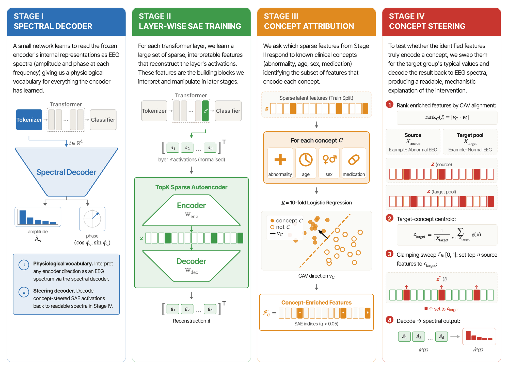

# Analysis pipeline

These are the scripts behind every result in the paper, grouped by the four pipeline stages of Figure 1. Run them from the repository root, in stage order: each stage consumes the outputs of the one before it.

The clinical cohort and finetuned encoder weights are private, so stages 0–IV do not run end to end from this repo. The code is here so the method can be audited and ported to another corpus or encoder. The [public-corpus replication](rebuttal/README.md) (TUAB, TUEV, TUSL) does run end to end.

## Stage 0 · Finetune and freeze the encoders (§2.1)

| Script | Produces |
|---|---|
| `finetune_sleepfm_v1_binary.py` | SleepFM finetuned on normal vs abnormal |
| `finetune_reve_binary.py` | REVE finetuned on normal vs abnormal |
| `finetune_labram_binary.py` | LaBraM finetuned on normal vs abnormal |
| `run_kfold_native_head.py` | K-fold finetune of the native classifier head, intact vs SAE-substituted |

## Stage I · Spectral decoder (§3.2, §4.2)

| Script | Produces |
|---|---|
| `train_spectral_decoder.py` | Spectral decoder per encoder → `results/spectral_decoder/{encoder}/` |
| `bootstrap_spectral_decoder_ci.py` | 95 % bootstrap CIs on amplitude R² and phase cosine |
| `compare_spectral_decoder.py` | Cross-encoder R² comparison (helper for the bootstrap) |

## Stage II · Layer-wise SAEs (§3.3, §4.1)

| Script | Produces |
|---|---|
| `train_sae_layers.py` | TopK SAE (E = 1, k = 8) on every layer → `results/features/{encoder}/sae_*.pt` |
| `train_sae_expansions.py`, `run_expansion_sweep.sh` | Expansion sweep E ∈ {1, 2, 4, 8, 16, 32, 64} (Figs. 3, 7) |
| `probe_layer_sweep_kfold.py` | SAE-substitution faithfulness at every layer, 5-fold (Fig. 2) |
| `probe_table_finetune_sae.py` | Linear-probe baseline vs SAE substitution at the operating layer (Table 1) |

## Stage III · Concept attribution and taxonomy (§3.4, §4.3)

| Script | Produces |
|---|---|
| `build_app_cache.py` | Per-experiment feature enrichment and spectral cache (input to stages III–IV) |
| `run_tcav.py` | CAVs, feature enrichment, and TCAV scores → `results/tcav/{experiment}/` |
| `build_taxonomy_cache.py` | Separable / Entangled / Dead fractions per (encoder, layer, E) (Fig. 3) |
| `analyze_monosemanticity.py` | Per-feature category-discrimination test |

## Stage IV · Concept steering (§3.5–3.6, §4.4–4.5)

| Script | Produces |
|---|---|
| `build_steering_cache.py` | Whole-cohort embeddings and metadata for steering → `results/steering_cache/{experiment}/` |
| `run_steering_sweep.sh` | Steering across the SAE expansion sweep |
| `rebuttal/run_fig4_multiseed.sh` → `rebuttal/steering_seed_robustness.py` | Excess selectivity over 5 SAE seeds (Figs. 4–5) |
| `rebuttal/steering_significance.py` | Permutation test against 200 random feature rankings |

## Robustness, baselines, and public replication (§4.6, App. B–H)

See [`rebuttal/README.md`](rebuttal/README.md): direction-source baselines (PCA, ICA, dense CAV), dedicated erasers (LEACE, INLP), the deployed classifier head, the TUAB / TUEV / TUSL replication, and seeded reruns.

## Figures

Each paper figure has a self-contained folder in [`paper_figures/`](paper_figures/) with `plot.py`, its bundled input data and the rendered output. See the [top-level README](../README.md#quickstart).

## What is not here

The development repo also holds the Streamlit app's cache builders for the layer and attention explorers, exploratory plots, the codebook clustering, and the granular-label experiments. None of these feed a paper figure or table, so they are left out of this companion repo.
