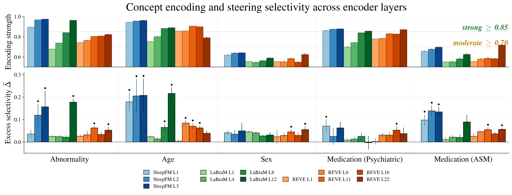

# Figure 4 — Concept encoding and steering selectivity across encoder layers (camera-ready)



Encoding strength (AUROC₀, top) and excess steering selectivity Δ̃ (bottom) for 5 clinical
concepts at SleepFM L1–3, LaBraM L1/4/8/12 and REVE L1/6/11/16/22 (1-based), with E = 1 and
k = 8 at every layer. Each bar is the mean over **5 independently seeded SAEs**, and error bars
are the sd across seeds. Dots mark cells that are selective in ≥ 3/5 seeds: permutation p < 0.05
against 200 random feature rankings, and Δ̃ ≥ 0.05.

```bash
uv run python "tools/paper_figures/Figure 4/plot.py"
```

`data.json` holds the per-seed, per-concept output of
`tools/rebuttal/steering_seed_robustness.py`, one entry per experiment. Each entry includes
curves, permutation nulls and bootstrap CIs. Regenerate it with
`tools/rebuttal/run_fig4_multiseed.sh`, which needs the steering caches.

**Changes from the submitted figure** (kept in `submitted/`):
1. Bars are seed means; the submitted bars were single draws, with error bars showing the sd of
   3 random rankings.
2. The selectivity axis is no longer clipped at 0, so negative Δ̃ can show.
3. Layer labels are the true layer indices. The submitted legend relabelled LaBraM and REVE
   layers; the data now come from the labelled layers.
