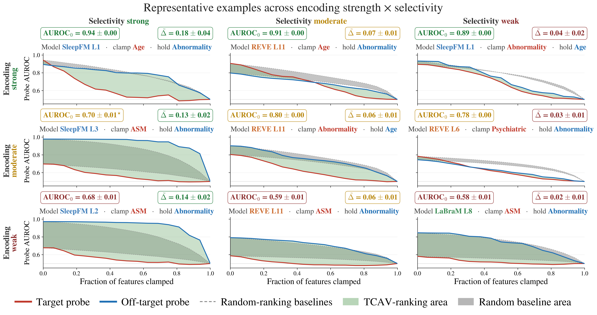

# Figure 5 — Steering sweeps across the encoding × selectivity landscape (camera-ready)



Nine cells from Figure 4, binned by encoding strength (rows) and selectivity (columns). Each
panel is the cell closest to its bin centre, chosen by rule only. Curves are means over 5 SAE
seeds. Uses the same `data.json` as Figure 4.

```bash
uv run python "tools/paper_figures/Figure 5/plot.py"
```

**Changes from the submitted figure** (kept in `submitted/`): seed-mean curves; no hand-picked
panel overrides; true layer labels (the submitted titles relabelled LaBraM/REVE layers).
